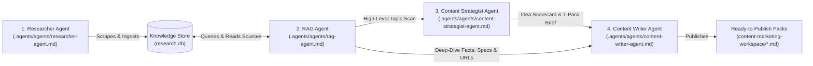

# Prompt Production

Multi-agent AI content production, trend intelligence RAG system, and Google Flow video script workspace built for **Google Antigravity**.

---

## System Architecture

The workspace implements the **Ace Social Media Content System**:



---

## Active Agent Roster

1. **`researcher-agent`**: Searches the web and social media (Reddit, Google News RSS, Bluesky, Mastodon, Hacker News), extracts canonical source URLs, and persists structured intelligence into `content-marketing-workspace/research.db`.
2. **`rag-agent`**: Executes full-text search (FTS5) queries against `research.db` and reads the full material directly from source URLs (`research_db.py read-source`), providing verified intelligence to other agents.
3. **`content-strategist`** *(Creative Director)*: Queries the RAG Agent to survey the database for broad topic clusters, formulates 2–3 candidate concepts, grades them on Ace's 4 taste pillars (out of 40 pts), and outputs an **Idea Pitch & Scorecard** with a 1-paragraph brief for the winner. Does not write scripts or copy.
4. **`content-writer`** *(Lead Copywriter)*: Takes the approved 1-paragraph concept, uses the RAG Agent to do the deep-dive factual investigation (pulling exact quotes, fabric weights, prices, and source URLs), and writes 100% of the creative production pack (4-column video scripts with `[Subject Anchor: Ace]` and Google Flow prompts, 8-slide carousels, Story funnels, and Social SEO captions with clickable citations).

---

## Repository Structure

```text
prompt-production/
├── README.md                                           # Project overview & architecture guide
├── Ace Social Media Content System Diagram-2.png      # Official system architecture diagram
├── .agents/                                            # Root Antigravity customizations (auto-loaded)
│   ├── agents/
│   │   ├── researcher-agent.md                         # Web/social search & ingestion agent
│   │   ├── rag-agent.md                                # Database retrieval & source URL reading agent
│   │   ├── content-strategist-agent.md                 # Concept ideation & grading scorecard agent
│   │   └── content-writer-agent.md                     # Script, carousel & Google Flow production agent
│   ├── rules/
│   │   └── AGENTS.md                                   # System rules & synthesis standards
│   └── skills/
│       ├── content-marketer/SKILL.md                   # Omnichannel growth & retention formulas
│       └── web-social-scraper/SKILL.md                 # Multi-platform scraping workflow
│
├── content-marketing-workspace/                        # Production Workspace & Knowledge Store
│   ├── research.db                                     # SQLite Knowledge Store (FTS5 indexed)
│   ├── scraped-trends/                                 # Human-readable scrape archives
│   └── *.md                                            # Generated production packs & campaign guides
│
└── web-social-scraper/                                 # Scraping & Retrieval Tooling
    ├── scripts/
    │   ├── scrape_sources.py                           # Multi-platform scraper CLI
    │   └── research_db.py                              # SQLite & FTS5 database CLI
    └── README.md
```
