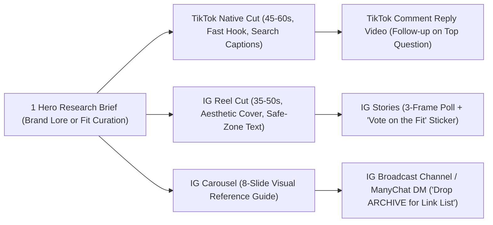

# Ace: Instagram & TikTok Viral Growth & Distribution Playbook

> [!IMPORTANT]
> **Campaign North Star:** Position **Ace** as the go-to culturally authentic AI style curator across streetwear, brand history, athletic style, and emerging fashion trends—driving **save-worthy authority** on Instagram and **share-driven discovery** on TikTok at a sustainable **4x/week cadence**.

---

## 1. Audience Persona & Cultural Positioning

| Segment | Profile & Mindset | Pain Points | Why They Follow Ace |
| :--- | :--- | :--- | :--- |
| **The Archive Enthusiast (18–34)** | Cares about heritage, designer lineage (ACG, Arc'teryx, vintage Nike, Japanese denim, Samba/Gazelle history). | Tired of surface-level "hypebeast" fast-fashion hauls with zero cultural context. | Deep-dive storytelling, obscure brand lore, and "if you know, you know" curation. |
| **The Everyday Fit Builder (16–28)** | Wants versatile streetwear + athletic style silhouettes without overpaying for resale hype. | Overwhelmed by micro-trends; unsure how to proportion silhouettes or spot quality. | Actionable proportion rules, sneaker/outerwear alternatives, and repeatable outfit formulas. |
| **The Trend Forecaster (20–35)** | Creatives, stylists, and early adopters watching gorpcore, terrace wear, and tech-runner shifts. | Wants early signals before trends hit mainstream saturation. | Data-backed trend radar, runway-to-street translations, and emerging label spotlights. |

### Brand Voice & AI Avatar Guardrails
* **Tone:** Informed insider, older-brother/archivist energy—never robotic, preachy, or corporate.
* **Transparency as a Superpower:** Own Ace's digital avatar identity with self-aware cultural fluency (*"I scanned 40 years of Nike ACG lookbooks so you don't dress like a mannequin"*).
* **Visual Signature:** Consistent lighting/grade on Ace's avatar + kinetic split-screen B-roll of real archival garments, runway clips, stitching close-ups, and graphic overlays.

---

## 2. Competitive Gap & Content Pillars

Most fashion accounts fall into two traps: **low-effort outfit checks** (high reach, zero authority) or **long-form fashion essays** (high authority, slow mobile pacing). Ace bridges the gap with **60-second visual storytelling + saveable cheat sheets**.

| Pillar | Share of Voice | Primary Format | Target Metric |
| :--- | :--- | :--- | :--- |
| **1. Hidden Brand Lore ("The Vault")** | 30% | 45–60s TikTok / IG Reel | **Watch Time & Shares** (DM sends) |
| **2. "Buy This, Not That" Curation** | 30% | IG 7–10 Slide Carousel + 35s Reel | **Saves & Bookmarks** (2.5%+ save rate) |
| **3. Athletic-to-Street Fit Formulas** | 25% | 30–45s Visual Breakdown Reel/TikTok | **Profile Visits & Follows** |
| **4. 90-Day Trend Radar** | 15% | Hot-Take Stitch / Duet / Green-Screen | **Comments & Debate Velocity** |

---

## 3. Omnichannel Repurposing & Distribution Engine

Each week requires only **4 core hero concepts**, multiplied across TikTok and Instagram using platform-native packaging:

---

## 4. Social SEO & Discovery Matrix

Both TikTok and Instagram index **spoken audio transcripts, on-screen text, and caption keywords**. Include 1 primary keyword phrase in Ace's spoken hook, on-screen header, and first caption sentence:

* **Streetwear & Curation Keywords:** `streetwear essentials 2026`, `underrated streetwear brands`, `how to style baggy jeans`, `best sneaker alternatives`, `japanese streetwear archive`
* **Brand History Keywords:** `brand history explained`, `why [brand] is so expensive`, `rise and fall of [brand]`, `iconic sneaker history`, `90s sportswear archive`
* **Athletic Style Keywords:** `retro runner rotation`, `gorpcore styling guide`, `vintage athletic wear`, `track jacket outfit ideas`, `terrace sneaker guide`
* **Hashtag Formula (3–5 Hyper-Relevant Tags Only):** `#streetweararchive` `#fashionhistory` `#mensstreetwear` `#sneakerhistory` `#outfitgrid`

---

## 5. 4-Week Sustainable Editorial Calendar (4 Posts/Week)

**Schedule:** Tuesday, Thursday, Saturday, Sunday
* **Peak Windows:** Tue/Thu 11:00 AM or 6:00 PM local; Sat/Sun 10:00 AM–1:00 PM local.

| Week | Tue (Pillar 1: Brand Lore Video) | Thu (Pillar 2: Curation Carousel + Reel) | Sat (Pillar 3: Athletic Style Breakdown) | Sun (Pillar 4: Trend Radar / Community) |
| :--- | :--- | :--- | :--- | :--- |
| **Week 1** | **The 1989 Nike ACG Experiment:** How outdoor gear conquered city streets. | **Stop Buying Overpriced Basics:** 5 heavyweight tees & hoodies built to last 10 years. | **The 3-Shoe Athletic Rotation:** 1 retro runner, 1 terrace classic, 1 trail hybrid. | **Dead vs. Next:** 3 streetwear micro-trends dying in 2026 (and what's replacing them). |
| **Week 2** | **How Champion Invented the Reverse Weave Hoodie** (for 1930s football players). | **If You Like [Hype Brand], Check Out These 4 Underground Labels** (Carousel + Audio Reel). | **Proportion Math:** The 1/3 to 2/3 rule for styling vintage track jackets with wide trousers. | **Stitch / React:** Breaking down the best & worst tunnel fits of the week. |
| **Week 3** | **Why Oakley's 90s Archive Still Looks Like 2050:** The mad-scientist era explained. | **Under-$150 Vintage Outerwear Gems** you can still find on Grailed/eBay right now. | **The Technical Shell Guide:** Arc'teryx vs. Salomon vs. vintage Patagonia. | **Audience Fit Audit:** Ace rates & upgrades 3 follower-submitted outfits. |
| **Week 4** | **How New Balance Went From "Dad Shoe" to Fashion Week Staple.** | **The Complete Japanese Denim & Workwear Starter Pack** (8-slide saveable guide). | **Summer-to-Fall Layering:** How to mix athletic jersey fabrics with structured outerwear. | **Q&A Reply Video:** Answering the top-liked comment from Weeks 1–3. |

---

## 6. Ready-to-Produce Hero Templates

### Template 1: Viral Brand Lore Video (TikTok & IG Reel — 45s)
* **[0:00–0:03] Visual & Spoken Hook:**
  * *Visual:* Ace appears split-screen over a zoomed-in archival 1990s catalog photo with kinetic text: `THE $12 SHIRT THAT CHANGED STREETWEAR`.
  * *Ace (Spoken):* "You've worn this stitching a hundred times, but almost nobody knows it was invented so football uniforms wouldn't shrink in the wash."
* **[0:03–0:15] The Origin Tension:**
  * *Visual:* Rapid 1.5-second cuts of vintage athletic photography, patent blueprints, and fabric cross-sections.
  * *Ace (Spoken):* Explain the functional problem the brand solved before fashion adopted it.
* **[0:15–0:35] The Cultural Crossover:**
  * *Visual:* Subculture adoption (90s skate, hip-hop, NYC/Tokyo street snaps).
  * *Ace (Spoken):* Connect the athletic innovation to street credibility and modern resale value.
* **[0:35–0:45] The Curation Payoff & Save CTA:**
  * *Visual:* On-screen checklist of the 3 specific vintage tag eras or modern equivalents to look for.
  * *Ace (Spoken):* "Screenshot this tag guide for your next thrift run—and drop which brand archive I should unlock next."

### Template 2: High-Save IG Carousel + TikTok Photo Mode (8 Slides)
* **Slide 1 (Hook Cover):** Bold editorial typography over Ace + garment cutout: *"Stop Buying Overhyped Runners: 5 Cult Alternatives With Better Materials."*
* **Slide 2 (The Problem):** Why mainstream colorways are saturated + the 3 criteria Ace uses to grade a sneaker (suede weight, midsole tech, silhouette versatility).
* **Slides 3–7 (The 5 Picks):**
  * Top half: Clean angled product shot + on-foot proportion reference.
  * Bottom half: `Model Name` | `Retail / Market Price` | `Why It Hits` | `How to Style It (Pant leg opening spec)`.
* **Slide 8 (Save & Share Trigger):** Full 5-shoe comparison cheat sheet on one screen + CTA: *"Save this for your next pickup & send to the friend still wearing beat Pandas."*

---

## 7. Distribution, Amplification & Community Loop

1. **First-30-Minute Velocity Protocol:**
   * Pin a **discussion-starter comment** from Ace immediately after publishing (e.g., *"Hot take: 1998 was peak athletic footwear design. What year beats it?"*).
   * Share the Reel to **IG Stories** within 15 minutes using a **2-option Poll Sticker** (*"Cop or Pass on Slide 4?"*) to trigger early Story engagement signals.
2. **Comment-to-DM Automation (ManyChat on IG):**
   * On curation posts, invite viewers to comment `ARCHIVE` or `ROTATION` to automatically receive a curated Notion/Substack spec sheet of links, sizing notes, and vintage search terms—boosting comment velocity while capturing superfans.
3. **Cross-Creator Collaborations & Stitches:**
   * Dedicate 1 slot per week to stitching/duetting sneaker archivist, vintage dealer, or athlete tunnel-fit clips, adding Ace's historical or styling breakdown.
4. **UTM & Link-in-Bio Tracking:**
   * Structure bio links with platform-specific parameters (`?utm_source=tiktok&utm_medium=bio&utm_campaign=ace_curation_w1`) to isolate TikTok vs. Instagram traffic.

---

## 8. KPI Targets & Verification Checklist

| Metric | Instagram Target | TikTok Target | Optimization Action if Below Target |
| :--- | :--- | :--- | :--- |
| **3-Second Hook Hold Rate** | > 65% | > 70% | Tighten opening visual contrast; move brand name + bold claim into first 1.5s. |
| **Average Watch Time** | > 50% of duration | > 45% of duration | Cut pauses between sentences; add visual pattern changes every 2.5 seconds. |
| **Save Rate (Saves / Reach)** | > 2.5% (Carousels > 4%) | > 2.0% | Add a screenshot-ready summary card in the final 4 seconds or last slide. |
| **Share Rate (Sends / Reach)** | > 1.5% | > 1.5% | Increase "insider flex" or debate value so viewers DM it to friends. |
| **Follower Conversion Rate** | > 1.2% of profile visits | > 1.5% of profile visits | Pin top 3 authority videos + clarify Ace's bio value proposition. |
