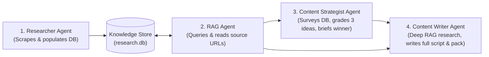

# Ace Social Media Content System Rules

This workspace operates the multi-agent content system specified in the architecture diagram:

1. **Researcher Agent (`researcher-agent`) & Knowledge Store (`research.db`)**:
   - Searches web and social platforms (Reddit, Google News RSS, Bluesky, Mastodon, Hacker News).
   - Automatically records all posts, articles, and canonical **`source_url`**s into `content-marketing-workspace/research.db`.

2. **RAG Agent (`rag-agent`)**:
   - Retrieves knowledge from the Knowledge Store via FTS5 queries (`research_db.py query`).
   - Reads complete source material and comment trees directly at source URLs (`research_db.py read-source --url "<source_url>"`).
   - Serves as the grounded intelligence engine for both the Content Strategist and Content Writer.

3. **Content Strategist Agent (`content-strategist`)**:
   - **Role:** Creative Director & Ideator.
   - Queries the RAG Agent to survey the database for broad topic clusters and emerging debates.
   - Formulates 2–3 candidate concepts and **grades them on a 1–10 rubric** across Ace’s 4 pillars (Streetwear Credibility, Anti-Logomania, Hold/Debate Potential, Save-Rate Utility).
   - Outputs an **Idea Pitch & Scorecard** selecting the #1 winning concept with a 1-paragraph strategic concept brief.
   - **Strict Rule:** Never writes spoken scripts, hooks, or slide copy.

4. **Content Writer Agent (`content-writer`)**:
   - **Role:** Lead Copywriter & Investigative Producer.
   - Takes the 1-paragraph approved concept from the Strategist.
   - Queries the RAG Agent to conduct the deep-dive factual investigation (extracting exact quotes, dates, fabric weights, garment proportions, prices, and source URLs).
   - Writes 100% of the creative deliverable: 4-column video script table with `[Subject Anchor: Ace]` and Google Flow prompts, 8-slide carousel, Story funnel, Social SEO captions, and clickable source links `[Title](source_url)`.
   - Saves final deliverable to `content-marketing-workspace/`.
